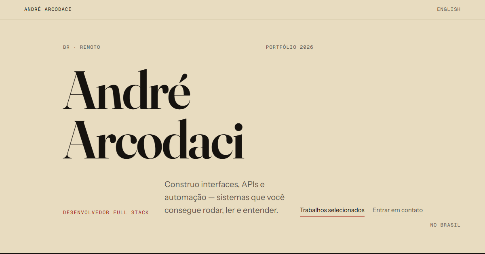

# Gate 4 — Acabamento

**Aguardando o dono.** A Fase 4 está implementada; o dono aprova o gate.

A Fase 4 deixou o site pronto para ser publicado, ainda com conteúdo mock:
cada rota vira um HTML estático no formato do Cloudflare Pages, com título,
descrição, `hreflang` e Open Graph próprios; o nome do hero não pisca antes da
entrada; há cabeçalhos de segurança e CSP; a acessibilidade foi auditada contra
a WCAG 2.2 AA e corrigida; a regressão visual não aceita diferença de pixel; e
a performance foi medida.

- Design: `docs/superpowers/specs/2026-10-27-fase-4-acabamento-design.md`
- Auditoria WCAG 2.2 AA: [`A11Y_AUDIT.md`](A11Y_AUDIT.md)
- Performance: [`PERFORMANCE.md`](PERFORMANCE.md)
- Arquitetura do prerender: `docs/ARCHITECTURE.md`, "Prerender"

## Como avaliar

```bash
pnpm build:preview && pnpm preview
# http://127.0.0.1:4173/        (EN)
# http://127.0.0.1:4173/pt      (PT)
# http://127.0.0.1:4173/work/map-areas
# http://127.0.0.1:4173/nao-existe   (404)
```

O preview serve `dist/` como o Cloudflare Pages (`vite-pages-preview.ts`),
com o mesmo `_redirects` e `_headers`. Para ver sem JS: DevTools, Settings,
Debugger, "Disable JavaScript".

## Critério do Gate 4

"Critérios 1 a 8 e 10 da §8 satisfeitos com evidência, `pnpm validate:preview`
verde e o dono aprova."

## Critérios da spec mãe (§8)

| # | Critério | Evidência |
| --- | --- | --- |
| 1 | Direção visual registrada, com as rejeitadas | `docs/DESIGN_DECISIONS.md` (Editorial Rolodex escolhida; 01 e 03 rejeitadas, com o motivo) |
| 2 | Nome, função e caminho para trabalhos e contato no primeiro viewport, sem gesto oculto | `e2e/first-viewport.spec.ts`; `e2e/entrance-early.spec.ts` (o nome nunca fica escondido além de 3 s) |
| 3 | Composição sustenta-se sem motion e com reduced motion | `e2e/motion.spec.ts`, `e2e/opening.spec.ts` (com `reduce`, zero animação); `e2e/a11y-audit.spec.ts` (reduced motion no meio da sessão); `scripts/motion-guard.test.ts` |
| 4 | Todo hover tem equivalente por teclado e por toque | `e2e/hover.spec.ts`, `e2e/keyboard.spec.ts`; auditoria 2.4.3, 2.4.7, 2.4.11 e 1.4.13 em [`A11Y_AUDIT.md`](A11Y_AUDIT.md) |
| 5 | Sem scroll hijacking, bloqueio de navegação ou transição que esconda conteúdo | `e2e/smooth-scroll.spec.ts` (Lenis só suaviza mouse e trackpad), `e2e/journey.spec.ts`, `e2e/title-flight.spec.ts`, `e2e/entrance-early.spec.ts` |
| 6 | Layouts em 390, 768 e 1440 sem overflow indevido | `e2e/responsive.spec.ts`; `e2e/a11y-audit.spec.ts` (`scrollWidth` igual à largura em 320, 390, 768 e 1440, também a 200% de texto); regressão visual `e2e/visual.visual.ts` |
| 7 | Paridade de chaves e rotas equivalentes nos dois locales | `src/content/content.test.ts` (chaves); `e2e/routing.spec.ts`; `src/app/prerenderRoutes.test.ts` (o mesmo conjunto de arquivos por locale); `e2e/prerender.spec.ts` (`hreflang` nos dois idiomas) |
| 8 | `pnpm build` falha com mock, salvo `ALLOW_MOCK=1` | `scripts/assert-no-mock.test.ts`; execução registrada em "Verificação final" |
| 9 | `pnpm validate` passa | **Fora do Gate 4: fecha na Fase 5.** `validate` encadeia `build`, que falha por desenho enquanto houver `mock: true` (critério 8). Os mocks só saem quando o repositório for publicado (decisão do dono, 2026-10-27). Aqui vale `pnpm validate:preview`, que troca `build` por `build:preview` e acrescenta `format:check` |
| 10 | `design/comps/` não existe | `design/` não existe na árvore (`ls design` falha) e `git ls-files design` não lista nada; registrado em `docs/DESIGN_DECISIONS.md` |

Além dos oito critérios, a fase tem testes próprios:

| O quê | Teste |
| --- | --- |
| Head por rota (título, descrição, canonical, `hreflang`, Open Graph, `noindex` no 404) | `src/app/head.test.ts`, `e2e/prerender.spec.ts` |
| Lista de rotas e arquivos do prerender, origem do site | `src/app/prerenderRoutes.test.ts`, `src/app/siteOrigin.test.ts` |
| HTML pré-renderizado: conteúdo sem JS, hidratação sem erro de console em todas as rotas | `e2e/prerender.spec.ts` |
| Preview imita o Pages (`_redirects`, `.html`, 404 mais próximo) | `vite-pages-preview.test.ts`, `e2e/routing.spec.ts` |
| CSP com hash do script inline, cabeçalhos, sem violações | `scripts/headers.test.ts`, `e2e/prerender.spec.ts` |
| Entrada do nome sem piscar | `src/app/entranceEarly.test.ts`, `e2e/entrance-early.spec.ts` |
| WCAG 2.2 AA (texto a 200%, espaçamento, alto contraste, foco) | `e2e/a11y-audit.spec.ts`, `e2e/a11y.spec.ts` |
| Regressão visual sem tolerância por pixel (24 baselines) | `e2e/visual.visual.ts` |
| Fraunces com hash em `/assets` e cache `immutable` | `e2e/motion.spec.ts` |

## Imagens Open Graph

Uma por idioma, 1200 × 630: o primeiro viewport real de `/` e `/pt`, com reduced
motion (`e2e/publish.capture.ts`):

| EN | PT |
| --- | --- |
|  |  |

Os textos são os de `site.meta` e mudam na Fase 5, com o conteúdo real.

## Auditoria e performance

- **Acessibilidade.** Pontuação de 41/52 para 51/52 em 13 critérios; oito
  correções, cada uma com teste visto falhando antes. O que resta é a decisão
  do dono sobre os filetes (abaixo). Nota visível: a 200% de texto em 320 px, o
  nome do hero e palavras longas quebram no meio ("Arcoda/ci"), efeito de
  `overflow-wrap: anywhere`. Detalhe em [`A11Y_AUDIT.md`](A11Y_AUDIT.md).
- **Performance.** LCP em laboratório (preview local, mediana de 3): home 756
  ms em 390 × 844, `/pt` 748 ms em 1440 × 900, case Map Areas 2344 ms, todos
  dentro do orçamento (LCP até 2,5 s, CLS até 0,1; CLS medido 0,0001 a
  0,0002). A Fraunces latin instanciada tira 54 kB do fio em toda rota; o
  preload das fontes foi testado e recusado. Não é Core Web Vitals de campo e
  INP não foi medido. Detalhe em [`PERFORMANCE.md`](PERFORMANCE.md).

## Aguardando o dono

1. **`/about` como página.** Recomendação do Claude: **não promover** — a seção
   da home é curta, o conteúdo é mock e uma página separada quebra a leitura de
   cima para baixo da abertura. Registrada em `docs/DESIGN_DECISIONS.md`
   (D-About), status aguardando o dono.
2. **Cor `--rule` nos filetes e no sublinhado de "Live demo".** Mede 2,10:1 no
   fundo e 2,39:1 na folha, abaixo dos 3:1. Tratada como decorativa: os
   filetes separam itens que já se separam por espaço, título e número, e o
   link é identificado pela posição e pela seta ↗, que não depende de cor. Não
   é falha AA nessa leitura. Duas opções da auditoria, se o dono discordar:
   (a) `--rule` para um tom com 3:1 nos dois fundos, em torno de `#8c7b55`, a
   confirmar na medida — muda a paleta aprovada; (b) só o sublinhado dos links
   inline em `--ink-muted`.
3. **Fraunces com `wght` fixo em 600.** Arquivo de 34,7 kB (−71%) em vez de
   66,9 kB (−44,7%, o adotado). Muda o desenho dos títulos e as 24 capturas da
   regressão visual falham; exige olhar o resultado e regravar as baselines
   (`pnpm test:visual:update`). Medidas em [`PERFORMANCE.md`](PERFORMANCE.md).
4. **Imagens OG e `apple-touch-icon`.** O `apple-touch-icon` é um quadrado
   escuro com cantos arredondados e "AA" claro em fonte sem serifa (fonte de
   fallback, não a Fraunces). Se os cantos arredondados forem transparentes
   no arquivo, é provável que o iOS os preencha de preto: não dá para
   verificar aqui. Olhe as duas imagens OG acima e `public/apple-touch-icon.png`
   e diga se aprova ou se quer o ícone com cantos retos e a Fraunces.
5. **Celular real.** A entrada do nome, o scroll, o toque nos links e o zoom
   do texto. Na mesma rede Wi-Fi: `pnpm build:preview && pnpm preview --host`
   e abra o endereço `Network:` no aparelho.
6. **NVDA nos pontos críticos** (design §7): a ordem do Tab da home, o nome do
   hero ("André Arcodaci"), o índice como `navigation`, o case aberto e o
   "Voltar", o 404, a troca de idioma. Confirme também se os números de seção
   ("01" antes do `h2`) incomodam; se sim, `aria-hidden` neles
   (`docs/BACKLOG.md`).
7. **Se quiser: `npx wrangler pages dev dist`** depois de `pnpm build:preview`,
   para conferir `/pt`, `/pt/qualquer` (404 em PT), os cabeçalhos e o CSP no
   servidor real. O preview local imita o Pages (confirmado no desenho), mas
   não é o Pages.

## Limitações conhecidas

- **404 sem JS.** O 404 é HTML estático e o seletor de idioma é um link comum:
  sem JS, o seletor leva ao 404 do outro idioma (`/pt/nao-existe` para
  `/nao-existe`), não à home. Com JS, o app troca o idioma preservando o
  caminho. Limitação do HTML estático.
- **Baselines visuais só `win32`.** Geradas nesta máquina, sem tolerância por
  pixel. Em outro sistema a suíte `visual` falha por antialias. Fase 5 regrava.
- **O preview não comprime (gzip)** como o Pages (`docs/BACKLOG.md`).
- **Folga do LCP do case: 156 ms** no preview sem gzip. Revisar com a capa
  real na Fase 5.

## Verificação final

Feita em 2026-10-27 na branch `fase-4-acabamento`, sem `rtk`, porta 4173 livre
antes de começar (só conexões em `TIME_WAIT`, nenhuma em `LISTENING`). O exit
code é a fonte de verdade.

### `pnpm validate:preview; echo "exit=$?"`

**exit=0.** typecheck, lint, `format:check`, Vitest, `build:preview` e o e2e
(projetos `chromium` e `visual`: **252 passed**) passam.

Uma rodada anterior falhou em 1 teste, `e2e/prerender.spec.ts` "a home executa o
script inline do head sob a CSP": ele sondava `data-entrance-early` depois do
`goto`, e o `Opening` já tinha tirado a marca (corrida com a hidratação). O
teste agora grava os valores da marca desde antes de qualquer script
(`addInitScript` com `MutationObserver`), exige `pending` na sequência e
nenhuma violação de CSP. Visto falhando com o hash do script errado em
`scripts/headers.ts` (recebido `[]`, script bloqueado) e passando com o código
real; a alteração temporária foi revertida.

### `pnpm build; echo "exit=$?"` — critério 8

**exit=1**, como deve ser enquanto houver mock:

```text
assert-no-mock: 12 item(ns) com mock: true
  en.site.approach.items[0] ... en.projects[1..3]
  pt.site.approach.items[0] ... pt.projects[1..3]
assert-no-mock: build bloqueado. Troque o conteúdo inventado ou use pnpm build:preview.
 ELIFECYCLE  Command failed with exit code 1.
```

### Sem `VITE_SITE_ORIGIN` e com `ALLOW_MOCK=1`

`env -u VITE_SITE_ORIGIN ALLOW_MOCK=1 pnpm build; echo "exit=$?"` → **exit=1**.
A trava de mock passa (liberada), o build do cliente e do servidor terminam, e
o prerender recusa a origem ausente:

```text
prerender: VITE_SITE_ORIGIN ausente. Defina VITE_SITE_ORIGIN com a origem absoluta do site, por exemplo https://exemplo.dev (veja .env.development)
 ELIFECYCLE  Command failed with exit code 1.
```

Merge na `main` só depois da aprovação do dono.
